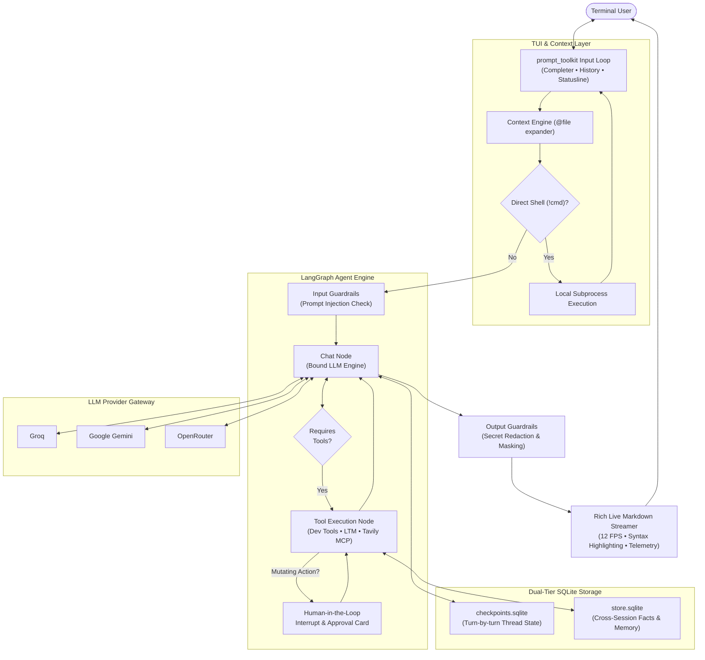

# Starvix (`starvix-agent-runtime`)

<div align="center">

```text
  ███████╗████████╗ █████╗ ██████╗ ██╗   ██╗██╗██╗  ██╗
  ██╔════╝╚══██╔══╝██╔══██╗██╔══██╗██║   ██║██║╚██╗██╔╝
  ███████╗   ██║   ███████║██████╔╝██║   ██║██║ ╚███╔╝ 
  ╚════██║   ██║   ██╔══██║██╔══██╗╚██╗ ██╔╝██║ ██╔██╗ 
  ███████║   ██║   ██║  ██║██║  ██║ ╚████╔╝ ██║██╔╝ ██╗
  ╚══════╝   ╚═╝   ╚═╝  ╚═╝╚═╝  ╚═╝  ╚═══╝  ╚═╝╚═╝  ╚═╝
```

**The Developer-First, Local-First LangGraph Agent Runtime**

<p>
  <a href="https://www.python.org/"></a>
  <a href="https://github.com/langchain-ai/langgraph"></a>
  <a href="https://www.langchain.com/"></a>
  <a href="https://sqlite.org/"></a>
  <a href="https://guardrailsai.com/"></a>
</p>

<p>
  <a href="https://rich.readthedocs.io/"></a>
  <a href="https://python-prompt-toolkit.readthedocs.io/"></a>
  <a href="https://typer.tiangolo.com/"></a>
  <a href="https://docs.pydantic.dev/"></a>
  <a href="https://github.com/astral-sh/uv"></a>
</p>

<p>
  <a href="https://groq.com/"></a>
  <a href="https://ai.google.dev/"></a>
  <a href="https://openrouter.ai/"></a>
  <a href="https://modelcontextprotocol.io/"></a>
  <a href="https://tavily.com/"></a>
</p>

<p>
  <a href="tests/"></a>
  <a href="LICENSE"></a>
</p>

*An advanced, privacy-conscious terminal agent engineered for developers. Powered by LangGraph state machines, dual-tier SQLite persistence, sandboxed coding tools with Human-in-the-Loop approvals, multi-provider model switching, and an IDE-grade Terminal User Interface.*

---

</div>

## Table of Contents

- [Key Features](#key-features)
- [System Architecture](#system-architecture)
- [Quick Start](#quick-start)
  - [Automated Setup (Recommended)](#1-automated-setup-recommended)
  - [Manual Setup (`uv` or `pip`)](#2-manual-setup-uv-or-pip)
  - [Environment Configuration](#3-environment-configuration)
- [CLI Usage](#cli-usage)
- [In-Session Commands & Shortcuts](#in-session-commands--shortcuts)
  - [Slash Commands Reference](#slash-commands-reference)
  - [Direct Shell Execution (`!<command>`)](#direct-shell-execution-command)
  - [File Context Injection (`@filename`)](#file-context-injection-filename)
- [Designer Themes & Statusline](#designer-themes--statusline)
- [Developer Tools & Human-in-the-Loop Safety](#developer-tools--human-in-the-loop-safety)
- [Security & Guardrails](#security--guardrails)
- [Configuration Reference (`config.yaml`)](#configuration-reference-configyaml)
- [Project Layout](#project-layout)
- [Testing](#testing)
- [License](#license)

---

## Key Features

- **IDE-Grade Terminal User Interface (TUI)**:
  - **Live Syntax-Highlighted Streaming**: Real-time 12 FPS Markdown AST rendering for flicker-free streaming of code blocks, tables, and formatted lists.
  - **10 Curated Designer Themes**: Seamlessly toggle between `strands`, `tokyo_night`, `catppuccin`, `dracula`, `nord`, `monokai`, `cyberpunk`, `spectre`, `matrix`, and `minimal`.
  - **Persistent Statusline**: Vim/Tmux-style sticky bottom bar displaying real-time active model, session thread, long-term memory counter, and shortcut hints.
  - **Tab Autocomplete & Dynamic Suggestions**: Intelligent tab completion powered by `prompt_toolkit` for slash commands, available models, SQLite threads, and memory keys.
  - **Reasoning Foldouts & Telemetry**: Support for `<think>` chain-of-thought blocks, collapsible tool execution branches, and generation metrics (`tokens/sec`, prompt/completion tokens, elapsed time).

- **Dual-Tier Memory System**:
  - **Short-Term Memory (STM)**: Checkpoint-based conversational continuity across turns using SQLite (`checkpoints.sqlite`), allowing thread resumption at any time.
  - **Long-Term Memory (LTM)**: Cross-session persistent user preferences and facts using LangGraph `InjectedStore` (`store.sqlite`). The agent autonomously recalls and records details across sessions.

- **Developer & Coding Agent Tools**:
  - Built-in workspace exploration and file manipulation: `list_files`, `find_files`, `grep_search`, `read_file`, `read_relevant_lines`, `get_file_outlines` (Python AST parser), `write_file`, `replace_code`, and `delete_file`.
  - Sandboxed terminal command execution (`run_terminal_cmd`) and repository inspection (`git_status`).
  - **Human-in-the-Loop (HITL)**: Interactive approval cards via LangGraph `interrupt()` prompt you before any mutating file edit, deletion, or terminal execution.

- **Developer Superpowers**:
  - **Direct Shell Pass-Through (`!<cmd>`)**: Run local commands like `!git status` or `!pytest -q` directly in your chat loop without wasting LLM tokens or round trips.
  - **Context Auto-Injection (`@file`)**: Mention any project file (e.g. `@src/agent_cli/graph.py`) to automatically parse and append its contents safely into the context window with file-size and binary guardrails.
  - **Export & Clipboard Utilities**: Instant clipboard copying with `/copy` (cross-platform with Wayland/X11 fallbacks) and clean conversation export to GitHub-flavored Markdown with `/export`.

- **Multi-Provider Model Engine**:
  - Zero-restart dynamic model switching via `/switch <model>`.
  - Native support for **Groq**, **Google Gemini**, and **OpenRouter** models (e.g., `qwen/qwen3.8-27b`, `gemini-2.5-flash`, `nvidia/nemotron-3-ultra-550b-a55b:free`).

- **Multi-Server MCP (Model Context Protocol)**:
  - Extensible tool orchestration supporting streamable HTTP MCP adapters (e.g., live Tavily web search).

- **Enterprise Guardrails**:
  - **Input Guardrails**: Prompt injection heuristics and safety checks blocking malicious payload injection before the model runs.
  - **Output Guardrails**: Automatic scanning and redaction of credentials, API keys, and sensitive tokens from responses.
  - **Tool & Path Guardrails**: Hardened workspace path-traversal prevention and blocked execution of dangerous destructive commands (`rm -rf`, fork bombs, privilege escalation).

---

## System Architecture



---

## Quick Start

### 1. Automated Setup (Recommended)

Starvix provides an automated installation script that checks prerequisites, sets up an isolated virtual environment, installs dependencies, configures `.env`, and creates a global `starvix` executable:

```bash
# Clone the repository
git clone https://github.com/your-username/starvix-agent-runtime.git
cd starvix-agent-runtime

# Run the installer
chmod +x install.sh
./install.sh
```

Once installed, the `starvix` command is globally available in `~/.local/bin/starvix` (ensure `~/.local/bin` is in your `$PATH`).

---

### 2. Manual Setup (`uv` or `pip`)

If you prefer managing your own virtual environment:

```bash
# Using uv (fastest)
uv venv
source .venv/bin/activate
uv pip install -e ".[dev,providers]"

# Or using standard pip
python3 -m venv .venv
source .venv/bin/activate
pip install -e ".[dev,providers]"
```

---

### 3. Environment Configuration

Copy the example environment file and configure your API credentials:

```bash
cp .env.example .env
```

Open `.env` and fill in the keys for the providers you wish to use:

```ini
# Core LLM Providers (at least one required)
GROQ_API_KEY="gsk_..."
OPENROUTER_API_KEY="sk-or-v1-..."
GOOGLE_API_KEY="AQ..."

# Optional: Web Search MCP Adapter
TAVILY_MCP_URL="https://mcp.tavily.com/mcp/?tavilyApiKey=..."

# Optional: LangSmith Tracing & Observability
LANGCHAIN_TRACING_V2=false
LANGCHAIN_API_KEY=""
LANGCHAIN_PROJECT="starvix-agent-runtime"

# Guardrails & Telemetry Controls
GUARDRAILS_DISABLE_TELEMETRY="true"
OTEL_SDK_DISABLED="true"
```

---

## CLI Usage

Launch Starvix using the CLI entrypoint:

```bash
# Start a new chat session with a fresh random thread ID
starvix chat

# Resume or join a specific conversation thread
starvix chat --thread session-abc12345
starvix chat -t project-migration

# List all saved conversation threads
starvix threads

# Check the runtime and environment status
starvix status

# View general CLI help
starvix --help
```

---

## In-Session Commands & Shortcuts

Inside the interactive chat interface, use slash commands and developer prefixes to control the session:

### Slash Commands Reference

| Command | Arguments | Description |
| :--- | :--- | :--- |
| **Session Control** | | |
| `/new` | `[thread_id]` | Start a brand-new conversation thread (generates random ID if omitted). |
| `/switch-thread` | `<thread_id>` | Switch context to an existing saved thread. Tab autocompletes saved IDs. |
| `/threads` | *none* | Display all saved persistent threads stored in SQLite. |
| `/thread` | *none* | Display the active thread ID. |
| `/exit`, `/quit` | *none* | Exit the chat session cleanly. |
| **Model & Providers** | | |
| `/models` | *none* | List all models defined in `config.yaml` and indicate the active model. |
| `/switch` | `<model_name>` | Hot-swap the active model (e.g. `/switch gemini_flash_2_5`). |
| **Long-Term Memory (LTM)** | | |
| `/list-memories` | *none* | Display all cross-session memories saved in SQLite. |
| `/delete-memory` | `<memory_id>` | Delete a specific memory key. Tab autocompletes memory IDs. |
| `/clear-memories` | *none* | Erase all stored long-term memories. |
| **Aesthetics & Display** | | |
| `/theme` | `[theme_name]` | View interactive theme swatches or switch theme (e.g. `/theme catppuccin`). |
| `/clear` | *none* | Clear the terminal display and re-render the session banner. |
| **Utilities & Context** | | |
| `/copy` | *none* | Copy the assistant's last response directly to your system clipboard. |
| `/export` | `[folder_path]` | Export the entire thread history to a clean Markdown file in `exports/`. |
| `/help` | *none* | Open the interactive categorized help card. |

---

### Direct Shell Execution (`!<command>`)

Need to check git diff, run a quick test, or inspect a directory without leaving the chat or consuming tokens? Prefix your prompt with `!`:

```text
You: !git status
You: !pytest tests/test_dev_tools.py -q
You: !ls -la src/agent_cli
```

The shell command executes locally in a subshell with a 45-second safety timeout, streaming standard output and error directly to your console.

---

### File Context Injection (`@filename`)

Tag any file in your project using `@path/to/file` anywhere in your message:

```text
You: Please review the routing logic in @src/agent_cli/graph.py and suggest improvements.
```

- **Workspace File Autocomplete**: Pressing `@` autocompletes matching repository files.
- **Auto-Expansion**: Starvix resolves the file, validates its safety, and embeds it into the context window as syntax-fenced code.
- **Safety Filters**: Binary files, `.git`, `__pycache__`, `.venv`, and files exceeding 250 KB are automatically protected against context overflow.

---

## Designer Themes & Statusline

Starvix includes **10 built-in designer palettes** that restyle the banners, borders, statusline, and syntax highlighting:

| Theme | Vibe / Palette | Primary Accent |
| :--- | :--- | :--- |
| `strands` *(Default)* | Deep charcoal with vibrant terminal emerald | `#68f58a` |
| `tokyo_night` | Iconic modern dark blue with soft pastels | `#7aa2f7` |
| `catppuccin` | Soothing Mocha pastel palette | `#cba6f7` |
| `dracula` | Classic high-contrast dark with electric purple | `#bd93f9` |
| `nord` | Arctic, north-bluish clean aesthetic | `#88c0d0` |
| `monokai` | Beloved warm developer dark scheme | `#a6e22e` |
| `cyberpunk` | High-energy neon yellow and cyan | `#00f0ff` |
| `spectre` | Crimson and slate stealth styling | `#ff374c` |
| `matrix` | Phosphor hacker green terminal glow | `#39ff14` |
| `minimal` | Monochromatic subtle slate for distraction-free coding | `#e0e0e0` |

Switch dynamically during chat with:
```text
/theme dracula
```
Or persist your preferred theme in [`config.yaml`](config.yaml).

---

## Developer Tools & Human-in-the-Loop Safety

Starvix grants your agent native coding capabilities strictly sandboxed within your workspace:

### 1. Workspace Exploration & Inspection
- `list_files(directory)`: List files and subfolders within a directory.
- `find_files(query, directory)`: Locate files matching a filename wildcard pattern.
- `grep_search(query, path)`: Case-insensitive content search across all workspace files with line numbers.
- `get_file_outlines(file_path)`: Uses Python's Abstract Syntax Tree (`ast`) to extract classes, functions, and method signatures without reading whole files.
- `read_file(file_path)`: Read complete content of workspace files.
- `read_relevant_lines(file_path, start_line, end_line)`: Read precise line slices (1-indexed) to save context window.

### 2. Code Authoring & Execution (Guarded by HITL)
- `write_file(file_path, content)`: Create or overwrite files.
- `replace_code(file_path, old_code, new_code)`: Targeted surgery on existing code blocks.
- `delete_file(file_path)`: Remove a file from the workspace.
- `run_terminal_cmd(cmd)`: Execute terminal commands within the workspace root.
- `git_status()`: Quick short status check of the git working tree.

### 🛡️ Human-in-the-Loop (HITL) Interruption
Before executing mutating actions (`write_file`, `replace_code`, `delete_file`, `run_terminal_cmd`), LangGraph triggers an `interrupt()` card:

```text
╭──────────────── Human Approval Required ────────────────╮
│ Action   : write_file                                   │
│ Target   : src/agent_cli/utils.py                       │
│ Message  : Write file 'src/agent_cli/utils.py'?         │
╰─────────────────────────────────────────────────────────╯
Approve execution? [y/N]:
```

If rejected, the agent gracefully receives a cancellation signal and adjusts its strategy.

---

## Security & Guardrails

Starvix enforces defense-in-depth across the execution lifecycle:

1. **Prompt Injection Prevention**:
   - Every incoming human query is evaluated against injection signatures before reaching the LLM. Flagged prompts are immediately rejected.
2. **Output Sanitization & Secret Masking**:
   - Model responses pass through an automated redaction filter that masks API keys, bearer tokens, private keys, and sensitive environment patterns before rendering to terminal.
3. **Workspace Jail & Path Traversal Block**:
   - File tools enforce strict workspace boundary checks (`_resolve_safe_path`). Access to parent directories (`../../`), `.env`, `.git/`, SSH keys (`id_rsa`), and shell configuration files (`.bashrc`) is strictly blocked.
4. **Dangerous Command Blocklist**:
   - Shell commands targeting disk formatters, fork bombs, recursive deletes (`rm -rf`), privilege escalation (`sudo`), or direct remote script execution (`curl | bash`) are blocked immediately by guardrail validators.

---

## Configuration Reference (`config.yaml`)

Manage models, directories, and interface preferences in `config.yaml`:

```yaml
# Active default model alias
current_model: openrouter:nvidia/nemotron-3-ultra-550b-a55b:free

# Model sampling temperature (0.0 to 2.0)
temperature: 0.7

# Runtime directories (resolved under ~/.starvix/)
workspace_dir: workspaces
data_dir: data
export_dir: exports
sandbox_dir: configs

# Model Aliases Registry (provider:model_id)
models:
  gpt_oss_20b: groq:openai/gpt-oss-20b
  gpt_oss_120b: groq:openai/gpt-oss-120b
  qwen_3_8_27b: groq:qwen/qwen3.8-27b
  gemini_flash_2_5_lite: google:gemini-2.5-flash-lite
  gemini_flash_2_5: google:gemini-2.5-flash
  nemotron_3_ultra: openrouter:nvidia/nemotron-3-ultra-550b-a55b:free
  nemotron_3_super_vl: openrouter:nvidia/nemotron-3.5-super-vl:free
  nemotron_3_super_120b: openrouter:nvidia/nemotron-3-super-120b-a12b:free

# Terminal Statusbar Configuration
statusbar:
  theme: strands          # Choose from the 10 designer themes
  # bg: "#101213"         # Optional: override individual hex colors
  # fg: "#eceff1"
```

---

## Project Layout

```text
starvix-agent-runtime/
├── config.yaml               # Runtime, model registry, & theme configuration
├── pyproject.toml            # Project specifications & optional dependencies
├── install.sh                # Automated installer & global launcher script
├── ui_enhancements_guide.md  # Detailed guide on TUI and renderer architecture
├── ltm_architecture_guide.md # Architectural deep-dive into the STM/LTM memory engine
├── src/
│   └── agent_cli/
│       ├── cli.py            # Typer CLI application entrypoint
│       ├── chat.py           # Core REPL, event loop, & streaming coordinator
│       ├── graph.py          # LangGraph StateGraph builder & error recovery
│       ├── node.py           # Model invocation node & guardrail wrappers
│       ├── models.py         # Multi-provider model loader (Groq, Google, OpenRouter)
│       ├── state.py          # AgentState TypedDict & system prompt definitions
│       ├── config.py         # Settings validator & YAML management
│       ├── guardrails/       # Security layer
│       │   ├── input_guard.py    # Injection & prompt validation
│       │   ├── output_guard.py   # Secret redaction & credential masking
│       │   ├── tool_guard.py     # Command & path safety verifications
│       │   └── validators.py     # Security regex patterns & blocklists
│       ├── tool/             # Agent tools
│       │   ├── dev_tools.py      # Code navigation, file editing, AST & terminal
│       │   ├── memory.py         # LTM save/search/delete via InjectedStore
│       │   └── tavily_tool.py    # MCP Tavily search integration
│       └── ui/               # Modular Terminal User Interface
│           ├── theme.py          # 10 Theme definitions & palette registry
│           ├── completer.py      # Tab completion & history suggestion engine
│           ├── statusline.py     # Bottom toolbar renderer
│           ├── renderer.py       # Live Markdown & <think> stream renderer
│           ├── banner.py         # Welcome panel & categorized /help table
│           ├── message_frame.py  # User cards, telemetry, & delimiters
│           ├── tool_card.py      # Collapsible tool execution & HITL dialogs
│           ├── context.py        # @file mention parser & context injection
│           ├── export.py         # Clipboard (/copy) & Markdown (/export)
│           ├── animation.py      # Startup shimmer effects
│           └── dialogs.py        # Confirmation dialogs & screen controls
└── tests/                    # Comprehensive unit & integration test suite (235 tests)
```

---

## Testing

Starvix includes a complete test suite covering the graph state machine, guardrails, TUI components, developer tools, and persistent memory:

```bash
# Activate your virtual environment
source ~/.local/share/starvix/venv/bin/activate
# or: source .venv/bin/activate

# Run all test suites
pytest

# Run tests in quiet mode with short tracebacks
pytest -q

# Run specific functional test suites
pytest tests/test_dev_tools.py
pytest tests/test_guardrails.py
pytest tests/test_tui_improvements.py
pytest tests/test_memory.py
```

```text
======================= 235 passed in 29.17s =======================
```

---

## License

This project is licensed under the [MIT License](LICENSE).
